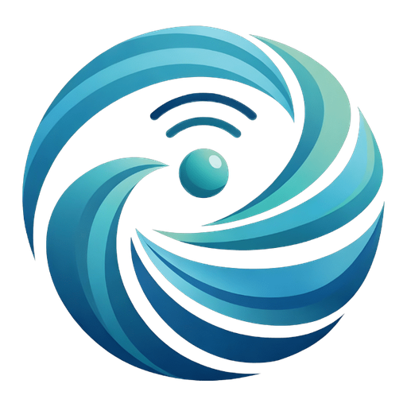

<div align="center">



# Marswalk

**Walk Mars before anyone does.**

A route planner and simulator for crewed walks on Mars, built on real NASA data.

`Python 3.13` · `FastAPI` · `NumPy` · `rasterio` · `scikit-image` · `PostgreSQL` · `Leaflet` · `three.js` · `Google Cloud Run`

[Live app](https://marswalk-266019376344.europe-west1.run.app/) · [Guided tour](https://marswalk-266019376344.europe-west1.run.app/tour.html) · [Short demo](https://marswalk-266019376344.europe-west1.run.app/tour.html?short=1) · [Slides](https://marswalk-266019376344.europe-west1.run.app/slides.html)

</div>

---

```
        ╔═══════════════════════════════════════════════════════╗
        ║                                                       ║
        ║   There is no GPS on Mars.                            ║
        ║                                                       ║
        ║   Marswalk plans the safest walk between your stops,  ║
        ║   forecasts how well the crew can be located along    ║
        ║   it, and lets you rehearse it in 3D or phone VR.     ║
        ║                                                       ║
        ║   ─────────────────────────────────────────────────   ║
        ║                                                       ║
        ║   terrain      NASA MOLA, MRO CTX, MRO HiRISE         ║
        ║   satellites   MRO, Odyssey, TGO, Mars Express        ║
        ║   orbits       NASA JPL Horizons, minute by minute    ║
        ║   anywhere     a new 178 km site in about a minute    ║
        ║                                                       ║
        ╚═══════════════════════════════════════════════════════╝
```

---

## Contents

| # | Section |
|---|---|
| 1 | [The Problem](#1--the-problem) |
| 2 | [What Marswalk Does](#2--what-marswalk-does) |
| 3 | [How It Works](#3--how-it-works) |
| 4 | [Data and Resources](#4--data-and-resources) |
| 5 | [Repository Layout](#5--repository-layout) |
| 6 | [Running It](#6--running-it) |
| 7 | [Models and Assumptions](#7--models-and-assumptions) |
| 8 | [Further Reading](#8--further-reading) |
| — | [Credits](#-credits) |

---

## 1 · The Problem

An astronaut a few kilometres from the habitat faces three problems at once:

| Problem | Why it matters |
|---|---|
| **The ground** | Crater walls, loose slopes, cold, darkness and radiation. A suited walker cannot take the straight line. |
| **Position** | There is no GPS. A suit's own estimate drifts with every step. |
| **Contact** | Hills hide the habitat's radio, relay satellites are overhead only a few times a day, and Earth is 4 to 24 light-minutes away. Mission control cannot steer a walk live. |

Marswalk plans around all three before anyone leaves the airlock.

---

## 2 · What Marswalk Does

| Capability | What the user gets |
|---|---|
| **Pick anywhere** | A 3D globe of Mars. Any point becomes a 178 km planning site, built on demand from NASA terrain. Jezero crater is a detailed site at 20 m. |
| **Read the ground** | Eight layers: elevation, slope, radiation dose, relay-satellite blind spots, habitat radio coverage, sunlight and shadow, ground temperature, and the planner's own cost. |
| **Plan the route** | The safest path between the stops, with three route styles (Safest, Balanced, Fastest) and a crew-rover option. |
| **Navigate without GPS** | A forecast of the position uncertainty along the route, from the suit's dead reckoning, the habitat's radio mast and real relay-satellite passes. |
| **Talk home** | A radio to the habitat and to Earth mission control, with the real light delay. A separate mission-control station runs in the browser. |
| **Rehearse it** | True-scale 3D, a first-person walk, a pressurised rover, and phone VR with gaze controls. |
| **Report it** | A two-page PDF mission report per plan: map, profile, satellite passes, navigation forecast and a go / no-go check. |

---

## 3 · How It Works

```
   NASA / USGS rasters ──▶  Python pipelines  ──▶  site layers  ──┐
   (MOLA, CTX, HiRISE,      (build_site,           (elevation,    │
    THEMIS, TES)             build_terrain, ...)     slope, ...)   │
                                                                   ▼
   NASA JPL Horizons   ──▶  fetch_passes      ──▶  PostgreSQL ──▶  FastAPI  ──▶  browser
   (orbits, Sun, Earth)     (every 6 hours)        + file cache    (routes,      (map, 3D,
                                                                    layers,       VR, radio,
                                                                    passes,       report)
                                                                    comms)
```

**The route.** The site is a grid of 20 m cells (463 m on global sites). Each cell gets a cost:

> walking time × (1 + slope penalty + 6 × weighted hazards)

The slope penalty is free under 3°, doubles the cost at 8° and multiplies it by 25 at 16°; anything steeper than the style's limit is blocked. A least-cost path search (scikit-image `MCP_Geometric`) finds the cheapest path, not the shortest one. That is why routes bend around hills.

**The position.** Between fixes, the suit's estimate drifts with the distance walked. While the habitat's mast has line of sight, it measures range and bearing. When a relay orbiter is in view, ranging and Doppler on its real orbit fix the position, and the route is re-planned from the corrected point.

**The radio.** Messages to the habitat travel in about a second. Messages to Earth leave only while a relay satellite is in view, then cross the real one-way light time from JPL Horizons; replies wait at the orbiter for the astronaut's next pass.

Full detail: [docs/ARCHITECTURE.md](docs/ARCHITECTURE.md) and [docs/PIPELINE.md](docs/PIPELINE.md).

---

## 4 · Data and Resources

Every number on the ground comes from a real dataset. Full list with direct file links: [DATA_SOURCES.md](DATA_SOURCES.md).

| Dataset | Mission / provider | Used for |
|---|---|---|
| [MOLA MEGDR 463 m elevation](https://asc-pds-services.s3.us-west-2.amazonaws.com/wms_basemaps3/Mars/MOLA/mola128_mola64_merge_90Nto90S_SimpleC_clon0_cog.tif) | Mars Global Surveyor · USGS Astrogeology | Every site on the globe, line of sight, air column |
| [CTX DTM 20 m and orthomosaic 6 m, Jezero](https://planetarymaps.usgs.gov/mosaic/mars2020_trn/CTX/JEZ_ctx_B_soc_008_DTM_MOLAtopography_DeltaGeoid_20m_Eqc_latTs0_lon0.tif) | Mars Reconnaissance Orbiter · USGS | The detailed Jezero site |
| [HiRISE DTM 1 m, Jezero](https://planetarymaps.usgs.gov/mosaic/mars2020_trn/HiRISE/JEZ_hirise_soc_006_DTM_MOLAtopography_DeltaGeoid_1m_Eqc_latTs0_lon0_blend40.tif) | Mars Reconnaissance Orbiter · USGS | Sharper slopes at Jezero |
| [THEMIS night and day IR, 100 m](https://asc-pds-services.s3.us-west-2.amazonaws.com/mosaic/Mars_MO_THEMIS-IR-Night_mosaic_60N60S_100m_v14.tif) | Mars Odyssey · USGS | Ground temperature model |
| [TES albedo](https://asc-pds-services.s3.us-west-2.amazonaws.com/mosaic/Mars_MGS_TES_Albedo_mosaic_global_7410m.tif) | Mars Global Surveyor · USGS | Ground temperature model |
| [NASA JPL Horizons](https://ssd.jpl.nasa.gov/horizons/) | NASA JPL | Orbits of MRO, Odyssey, TGO, Mars Express; the Sun; the Earth light delay |
| [Curiosity RAD](https://doi.org/10.1126/science.1244797) | Mars Science Laboratory | Measured surface radiation dose |
| [NASA Mars Trek](https://trek.nasa.gov/mars/) | NASA | Viking MDIM 2.1 colour mosaic |

Partner and open-source resources: [ESA Mars Express](https://www.esa.int/Science_Exploration/Space_Science/Mars_Express) and [ExoMars TGO](https://www.esa.int/Science_Exploration/Human_and_Robotic_Exploration/Exploration/ExoMars) (relay orbiters), [USGS Astrogeology](https://astrogeology.usgs.gov), [QGIS](https://qgis.org), [rasterio](https://rasterio.readthedocs.io), [NumPy](https://numpy.org), [scikit-image](https://scikit-image.org), [FastAPI](https://fastapi.tiangolo.com), [PostgreSQL](https://www.postgresql.org), [Leaflet](https://leafletjs.com), [three.js](https://threejs.org), [Google Cloud Run](https://cloud.google.com/run).

---

## 5 · Repository Layout

| Path | Contents |
|---|---|
| `app/main.py` | FastAPI server: sites, layers, route planner, satellite passes, scheduler |
| `app/comms.py` | Radio messages between the astronaut, the habitat and Earth, with light delay |
| `pipeline/` | Data pipelines: global sites, Jezero terrain, HiRISE slopes, ground heat, satellite passes |
| `web/` | The front end: homepage, globe, planner, 3D and VR, tour, mission control, slides, report |
| `tests/smoke_test.py` | End-to-end check of a running server |
| `docs/` | Architecture and pipeline reference |
| `DATA_SOURCES.md` | Every dataset with a direct link |

Built terrain lives in `data/` and is not stored in git; the pipelines rebuild it.

---

## 6 · Running It

```bash
pip install -r requirements.txt
python pipeline/build_terrain.py        # Jezero, about 3 minutes
python -m uvicorn app.main:app --port 8077
```

Open `http://localhost:8077`. Any other place on Mars is built the first time it is opened from the globe. Satellite passes come from JPL Horizons and are cached, so PostgreSQL is optional for a local run.

To check a running server end to end: `python tests/smoke_test.py http://127.0.0.1:8077`.

---

## 7 · Models and Assumptions

Marswalk labels every value that is a model or an assumption rather than a measurement.

| Quantity | Value | Status |
|---|---|---|
| Walking speed | Tobler's hiking function at half pace | Assumption |
| Rover speed | About 10 km/h on flat ground, up to 20° | Assumption |
| Dead-reckoning drift | 2 % of the distance since the last fix | Assumption |
| Habitat radio fix | ±5 m in range, ±1° in bearing, line of sight only | Assumption |
| Satellite fix | About ±5 m after a pass of at least a minute | Assumption |
| Radiation | 0.67 mSv/day at Gale, scaled by air column and open sky | Model on a measurement |
| Ground temperature | THEMIS and TES through a one-dimensional heat model | Model on real inputs |

---

## 8 · Further Reading

| Document | Covers |
|---|---|
| [docs/ARCHITECTURE.md](docs/ARCHITECTURE.md) | Components, request flow, storage, scheduling, failure behaviour, deployment |
| [docs/PIPELINE.md](docs/PIPELINE.md) | Every data pipeline, stage by stage, and the layers they produce |
| [DATA_SOURCES.md](DATA_SOURCES.md) | Every dataset and resource, with links |

---

## ◆ Credits

Built by **Saeed Hersheh**, team lead of [AirAwareNetwork](https://airaware.network/), a Palestinian, community-led air-quality network built on IoT, for the **NASA Space Apps Challenge 2026**.

Built with help from AI assistants (Claude and Gemini). The voice-over uses the browser's text-to-speech. Marswalk is not affiliated with NASA.
